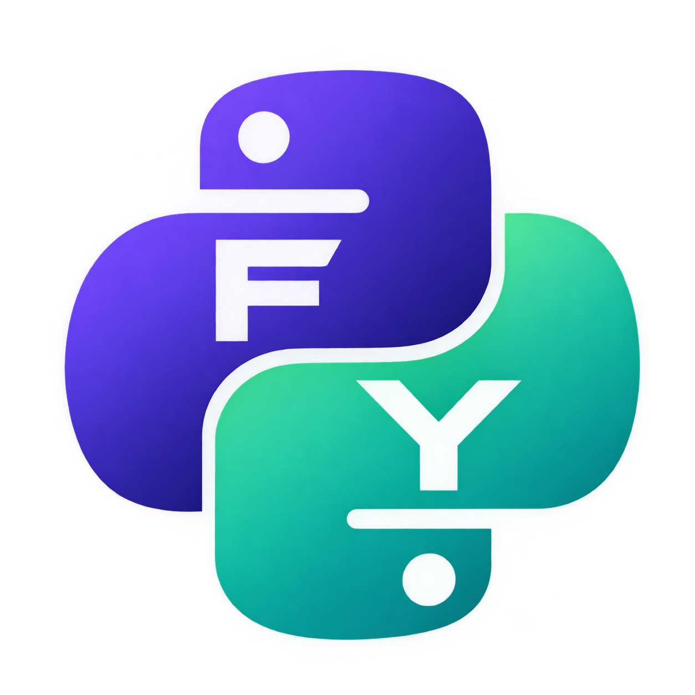

# FY — Programming Language

FY is a Python-inspired programming language designed to be faster, more advanced, and smarter, with the goal of improving upon Python's simplicity and capabilities.

## General Information

- Project: FY
- Language: Python-based implementation
- Status: In development

## Development

FY is actively being developed. Features, syntax, and implementation details may change.

## Documentation

Language documentation and examples will be maintained in this repository as the project grows.

## Contributing

Contributions, bug reports, and feature suggestions are welcome.

Please test changes before submitting a pull request.

## License

See the "LICENSE" file for the project's licensing terms.


# Release Date
Releasing Under 1 Week, PreRelease Is Here, How To Install 

- Step 1
``` git clone ```
- Step 2
``` cd FY ```
- Step 3
Run This Command:
``` ./build.sh ```
And Done Use It Using fy Like This fy example.fy

# Icon
<p align="center">
  
</p>
